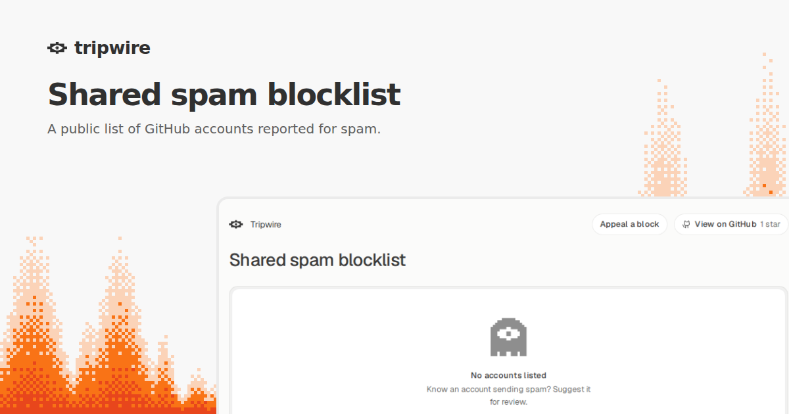

# Pilot

A public list of GitHub accounts reported for spam and reviewed by maintainers.

[Browse the list](https://staging.tripwire.sh/pilot) · [JSON snapshot](https://raw.githubusercontent.com/Boring-Software-Inc/Pilot/published/snapshot.json) · [Raw usernames](https://staging.tripwire.sh/api/blocklist?format=txt)

## Suggest an account

1. [Open a report on GitHub](../../issues/new?title=Suggest%20an%20account).
2. Add the GitHub username or profile URL. Describe the spam and link to public examples, such as pull requests or comments.
3. Submit the report. A maintainer reviews the evidence before adding an account.

Keep private evidence out of public issues. Being a bot or having a new account is insufficient on its own.

## Appeal a block

1. Choose **Appeal a block** on the [list page](https://staging.tripwire.sh/pilot).
2. Share the GitHub username or profile URL and explain what should change.

## Publish a change

- Verify the account and the evidence. Add it through Tripwire Admin or submit a PR under [`entries/`](./entries).
- Use the numeric GitHub ID as the filename. Include `accountId`, `login`, and a public `reason` of up to 300 characters.
- Omit `expiresAt` for a permanent entry. For a temporary entry, set a UTC timestamp such as `2027-01-31T00:00:00Z`.
- Remove community entries by PR. Remove admin entries with the [Publish blocklist workflow](../../actions/workflows/publish-snapshot.yml) using `operation: remove` and the account ID.

GitHub Actions republishes the snapshot after a merge and refreshes it daily. Tripwire's opt-in pilot sends matching pull requests to Human review.
